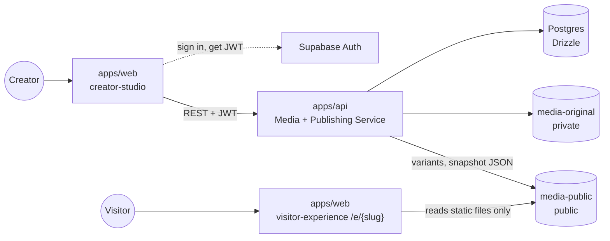
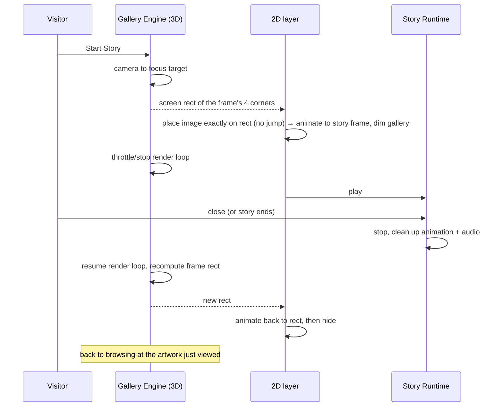
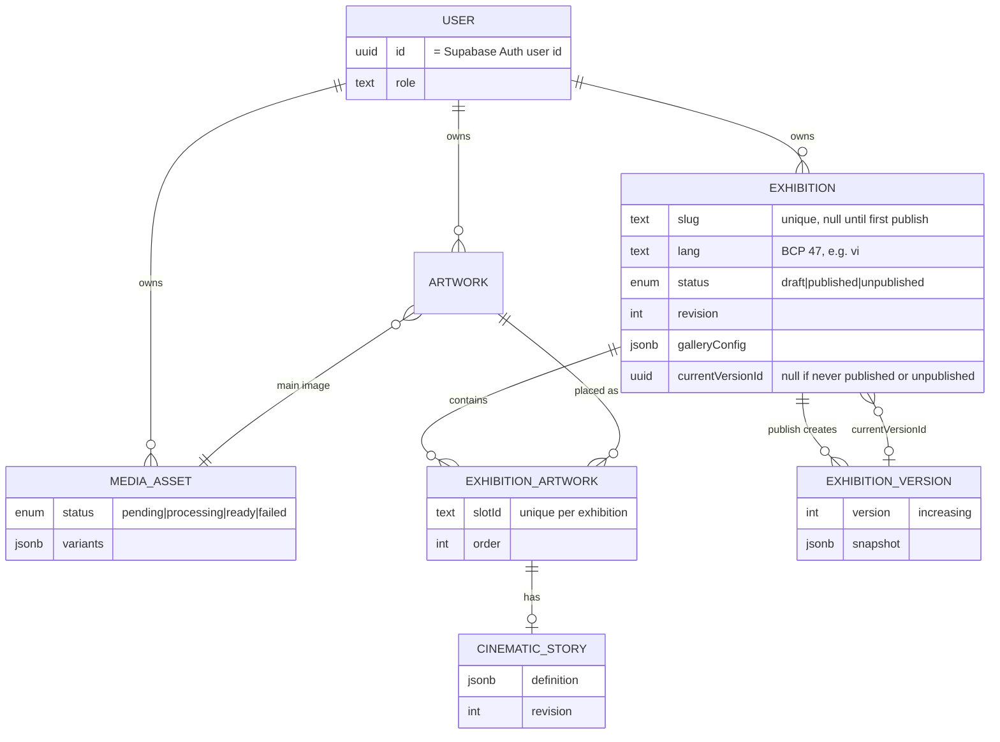
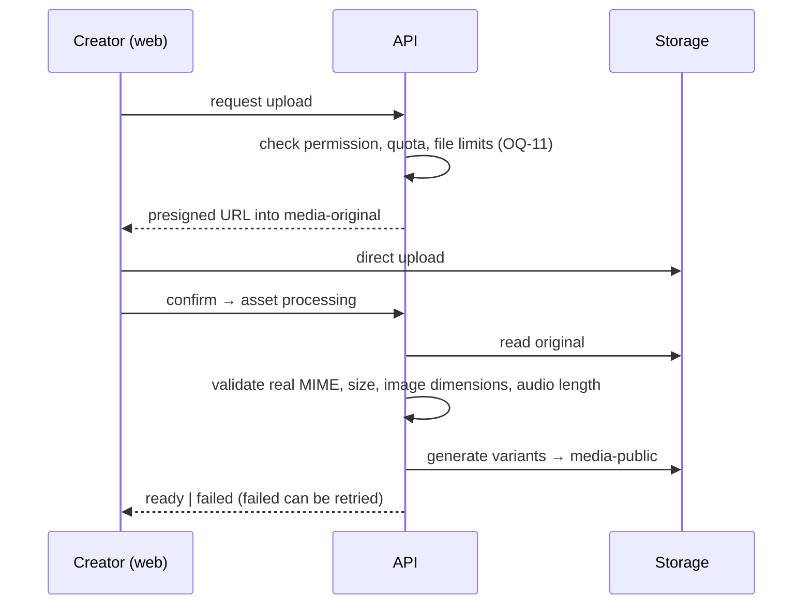
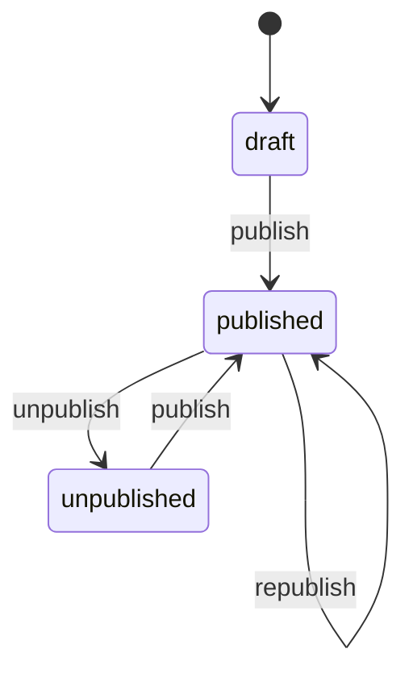
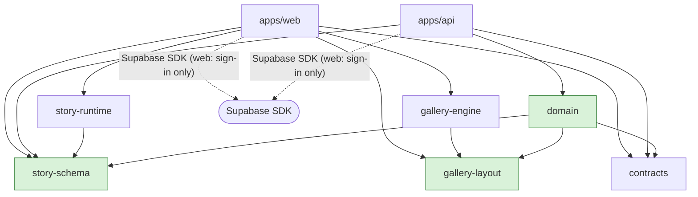

# High-Level Design — MuseSpace

**Version:** 1.0 · **Status:** Draft · **Architecture:** Modular Monolith, pnpm monorepo
**Main stack:** React, TypeScript, React Three Fiber, GSAP, Node.js (Fastify), PostgreSQL (Supabase)

> **Scope:** The HLD is the shared architectural constraint; numbers and error flows here are guidance. Once `specs/00X-*/spec.md` + `plan.md` are approved, the spec/plan wins for that feature and the HLD is updated in the same PR.
>
> §1–3 (overview, scope, user journeys) and the acceptance criteria `AC-xx` (vision §5) live in [`00-vision.md`](./00-vision.md). §14 (roadmap) lives in [`ROADMAP.md`](./ROADMAP.md). Decisions: [`OPEN-QUESTIONS.md`](./OPEN-QUESTIONS.md).
>
> Section numbers are kept stable so specs can cite them; gaps in numbering are intentional.

---

## 4. High-Level Architecture



- Supabase is infrastructure only (DB, Auth, Storage), accessed through open standards: connection string, S3 API, JWT (ADR-008).
- All Creator data goes through the Backend API. The frontend uses the Supabase client only for sign-in/sign-out.
- Visitors only read the published snapshot; they never call the API or DB (ADR-009).

### 4.1. Frontend (`apps/web`)

Public pages, 3D Gallery Viewer, Living Canvas Player, Creator Dashboard, Gallery Customization Studio, Artwork Management, Story Director, Exhibition Preview. UI text is English (OQ-22); all UI strings live in one file per app so they can be translated later.

### 4.2. Backend (`apps/api`)

JWT verification + authorization; CRUD for exhibition/artwork/story; presigned URLs and inline media processing (ADR-012); storing drafts and published versions; validation before publish; writing the snapshot on publish/unpublish.

### 4.3. Core Modules

| Module | Location | Responsibility |
|---|---|---|
| Exhibition Domain | `domain` | Exhibitions, room configuration, artwork list, publishing lifecycle |
| Gallery Engine | `gallery-engine` | Builds the 3D room from template + layout |
| Gallery Layout Engine | `gallery-layout` | Maps artworks to slots, size, orientation, camera target |
| Story Schema | `story-schema` | Story structure, validation, scene timing, migration |
| Living Canvas Runtime | `story-runtime` | Plays animation, transitions, audio, captions along the timeline |
| Story Director | `apps/web` | Timeline editor for creators |
| Media Service | `apps/api` | Upload, validation, variant generation (inline, ADR-012) |
| Publishing Service | `apps/api` | Validation, immutable versions, snapshot writing |

### 4.4. Architectural Principles

1. Story Director and Living Canvas Player share the same story schema and runtime.
2. A story is data, not executable code.
3. The rendering engine contains no business logic.
4. Draft and published content are separate.
5. The runtime does not depend on the backend while playing.
6. Important domain rules are pure functions where possible.
7. Business code does not depend directly on the Supabase SDK.
8. The Visitor flow never calls the Backend API or database.
9. The runtime does not control the Gallery Engine directly; it only emits events and the Gallery decides how to react.

---

## 5. 3D Gallery Design

**Templates (ADR-001).** The MVP ships `minimal` (light walls, natural light; MVP-0) and `dark` (dark walls, spotlights; MVP-1). Each template defines room geometry, wall surfaces, wall slots, lighting anchors, camera viewpoints, entrance and decoration presets. Templates live in code and are versioned (`minimal@1`); changing geometry/slots/cameras creates a new version, and old versions are kept for published exhibitions. Creators never edit meshes.

**Customization (MVP-1).** Wall color, floor material, lighting preset, artwork frame, arrangement. Reflected immediately in the 3D preview.

**Artwork placement.** Creators assign/move/swap artworks between predefined slots; no free drag-and-drop. The Layout Engine preserves aspect ratio, caps size, centers the artwork in its slot, sets position/orientation and computes the camera focus target.

**Visitor navigation.** Point-and-click: click an artwork → camera moves smoothly to it; Next/Previous or arrow keys; Return to overview. No character controller or physics.

**Grid view.** Thumbnail + title + Start Story, built from the same snapshot. Used when WebGL is unavailable, when the Visitor picks the simple mode, and for keyboard/screen-reader navigation.

---

## 6. Living Canvas Design

### 6.1. Concept

Each artwork in an exhibition can have a **Cinematic Story**: data describing what happens at each moment, rendered live in the browser (not a video). Scenes follow one another on **one continuous canvas**, not as slides.

### 6.2. Story Components

| Component | Purpose |
|---|---|
| Artwork Visual | The artwork's main image |
| Virtual Camera | Pan, zoom, focus, reveal on the 2D layer |
| Overlay Layer | Archival images, quotes, captions |
| Audio Track | One narration + one ambient track (optional; ambient is MVP-1) |
| Atmosphere Layer (MVP-1) | Background color and dimming of the 2D layer |
| Story Timeline | Coordinates timing and motion |
| Playback Controls | Play, pause, seek, skip, volume |

### 6.3. Supported Effects

Effects are presets that take parameters; arbitrary animation scripts are not allowed.

| Effect | Description | Milestone |
|---|---|---|
| Cinematic Focus | Slow zoom into a creator-selected region | MVP-0 |
| Memory Reveal | An archival image fades in/out, over or beside the artwork; params `{ assetId, placement }`. This is the only way to show an overlay image | MVP-0 |
| Final Reveal | Virtual camera pulls back to show the whole artwork | MVP-0 |
| Detail Journey | Moves between key regions of the artwork | MVP-1 |
| Atmosphere Transition | Changes dimming/background color of the 2D layer; emits an `atmosphere` event (e.g. `{ dim: 0.7, tint: "#1a1a2e" }`) the Gallery may listen to; the story still renders correctly with no listener | MVP-1 |

(OQ-01, OQ-09)

### 6.4. Rendering Strategy (ADR-002)

Two layers: **3D** (room, artworks, camera navigation) and **Cinematic 2D** (high-resolution image, pan/zoom, overlays, captions). All effects run on 2D; 3D only takes part when a story opens/closes. The app (`visitor-experience` or Story Director) coordinates the two layers.



### 6.5. Timeline Synchronization (ADR-010)

- **One master clock**, based on `performance.now()` minus paused time.
- **With narration:** narration plays through an `<audio>` element (streams, no full decode as with Web Audio). Before `startAtMs` (lead-in) the clock runs on `performance.now()` alone. From `startAtMs` on, the clock is re-anchored to `startAtMs + audio.currentTime` on the `playing`, `seeked` and `timeupdate` events and interpolated with `performance.now()` between them.
- The GSAP timeline stays paused and is seeked to the clock value every frame. Animation, overlays, captions and ambient audio all read the same value.
- Narration buffering → clock stops. Clock/audio drift > 100 ms → re-anchor to the audio.
- Anchoring and interpolation are pure logic in `story-runtime`, unit-tested with a fake clock. A spike on the supported desktop browsers (OQ-10) in ROADMAP feature 005 is the go/no-go for this approach.
- Supports: play, pause, resume, seek, restart, completion, cleanup when switching artwork.
- No chains of `setTimeout()` for orchestration.

### 6.6. Focus Region Fit

Focus regions use relative coordinates (0–1). Rule: **contain with a 5% safe margin**: the whole region always fits in the viewport; leftover space shows the surrounding image; the view is clamped to the image bounds, and beyond them the Atmosphere background shows. Story Director previews at 16:9 only (other ratios are out of MVP scope); the contain rule handles other desktop window shapes.

### 6.7. Reduced Motion and Static Mode

| | Reduced Motion (`prefers-reduced-motion` or user option) | Static Mode (MVP-1) |
|---|---|---|
| Motion | No pan/zoom/camera; each scene shows the effect's final view | Static view |
| Scene change | Crossfade, following the timeline | Visitor presses Next/Previous |
| Audio | Narration kept | No autoplay |
| Text | Captions unchanged | Caption + matching transcript excerpt |

Reduced Motion also applies outside the story (AC-08): 3D camera moves between artworks (§5) and the 3D↔2D transition (§6.4) become an instant cut or a crossfade.

---

## 7. Story Director Design

**Goal (ADR-005).** Creators build stories from **scene templates**: pick an effect, adjust duration, focus region, text, images, audio. No free keyframes or arbitrary tracks.

**Interface:** Preview Canvas · Timeline (scenes + narration track) · Media Library · Properties Inspector.

**Workflow:** select artwork → create story → add scene from template → pick focus on the image → set duration → add text/archival media/audio → preview → save draft.

**MVP-0 features:** add/remove/reorder scenes, choose effect, edit parameters, duration, focus region, attach media, live 16:9 preview, autosave. **MVP-1:** undo/redo.

### 7.5. Autosave and Concurrency

- Autosave sends the full story definition 2 seconds after the last edit. (OQ-06)
- Optimistic concurrency via `revision`: the request carries the client's revision; match → save and increment; mismatch → `409 Conflict`, nothing written; the client offers to reload the latest or overwrite after confirmation.
- Undo/redo (MVP-1) is client-side history and survives autosave.
- The same mechanism applies to exhibitions and gallery configuration.

### 7.6. Preview Consistency (ADR-004)

Story Director uses exactly the same Story Runtime as the Visitor Player.

---

## 8. Core Data Model

### 8.1. Main Entities



Gallery configuration and story definitions are JSONB, validated by versioned Zod schemas; scenes/effects are not split into tables (ADR-011). Stories reference media by `assetId` inside the JSON, not by foreign key.

DB constraints: `exhibition.slug` is unique and null until first publish. `(exhibitionId, slotId)` is unique, so two artworks can never share a slot, even when two tabs edit at once (AC-03; `EXHIBITION_ARTWORK` has no `revision`). `lang` is the content language of the exhibition and its stories (captions, transcript), used for screen readers and font choice.

### 8.2. Story Definition

```text
CinematicStory.definition
├── schemaVersion
├── narration?   { assetId, startAtMs, durationMs }
├── ambient?     { assetId, volume }   (MVP-1)
├── transcript?  text
└── scenes[]     (ordered)
    ├── id, durationMs
    ├── effect   { type, params }
    └── caption?
```

- Scenes do not store a start time; `startMs` and total duration are pure functions of the `durationMs` values.
- Narration is optional; a caption-only story is valid. At most one narration; `startAtMs + durationMs ≤ totalDuration`, checked in `story-schema`.
- A story with narration must have a transcript.
- Every `assetId` must point to a `ready` MediaAsset owned by the same creator — checked in `domain` (needs media data), not in `story-schema`. `domain` also checks that `narration.durationMs` matches the asset's measured duration.
- Overlay images exist only as Memory Reveal parameters; there is no scene-level overlay field (OQ-09).

**Example** — *The Chair by the Window* (reference story, AC-15; MVP-0 effects only): Cinematic Focus 15s → Memory Reveal 25s → Final Reveal 25s = 65s; narration `startAtMs = 5000`, 55s long → ends at 60s ≤ 65s, valid. Durations are samples, not hard limits.

### 8.4. Data Ownership

- An artwork belongs to its creator and can be used in several of that creator's exhibitions.
- A story is attached to an ExhibitionArtwork: the same artwork can have a different story in each exhibition.
- Changing slot only changes the ExhibitionArtwork, not the story. Removing an artwork from an exhibition deletes its draft story there after the creator confirms. (OQ-04)
- Deletion (OQ-17): a creator can delete an exhibition only while it is draft or unpublished (unpublish first). An artwork used in any published version cannot be deleted. Assets of deleted items stay in storage (no cleanup job, §8.5). No self-service account deletion in the MVP; done manually on request.

### 8.5. Immutability and Versioning

| Object | Rule |
|---|---|
| `ready` MediaAsset | Immutable; replacing an image = new asset + updated reference. The MVP has no asset delete operation and no cleanup job, so an asset referenced by a version can never disappear. Storage use is watched against the quota (§16); takedowns follow OQ-16. |
| Template | Versioned (§5); old versions are never deleted. |
| Published snapshot | Enough to render without reading the DB: `snapshotVersion`, exhibition info + `lang`, template id + version, gallery config, artworks (metadata, slot, variant URLs), an `assets` map resolving every `assetId` used by stories to its public URLs (plus `durationMs` for audio), story definitions migrated to the latest schema at publish time. The snapshot format is versioned by `snapshotVersion`; readers migrate older snapshots on read, as with stories. |
| Story schema | `migrate(definition)` upgrades step by step vN → vN+1 to the latest. Drafts are migrated in memory on read and persisted by the next save; reading never writes, because writing would bump `revision` and cause a spurious `409` in other tabs (§7.5). Published snapshots are never rewritten — the runtime calls `migrate` when reading them. |

---

## 9. Backend, Storage & Infrastructure

### 9.1. Database

Postgres (Supabase) via Drizzle ORM over a standard connection string; holds every entity in §8.1. Migrations only via Drizzle Kit, never Supabase CLI migrations. Authorization lives in the Backend API; RLS is not the primary authorization layer.

**Supabase Data API lockdown.** The frontend ships the anon key for sign-in, and Supabase's Data API (PostgREST) could expose application tables to anyone holding it, bypassing the Backend API. The Data API is therefore disabled for application schemas (or grants for `anon`/`authenticated` are revoked and RLS is enabled with no policies), and an integration test proves the anon key can neither read nor write any application table.

### 9.2. Media Storage

Supabase Storage via the S3 API (switch to R2/S3 by configuration).

| Bucket | Contents | Access |
|---|---|---|
| `media-original` | Original files | Private, backend only |
| `media-public` | Variants + published snapshots | Public, paths contain random UUIDs |

Variants are written straight to the public bucket so publishing needs no file copy; the trade-off is that draft media is viewable by anyone with the URL. Accepted for the MVP. (OQ-03)



**Inline processing (ADR-012).** Variants are generated inside the confirm request, not by a job queue. To stay within the free API host's memory: input size and pixel caps (OQ-11), and one file at a time per API process (in-process mutex). An asset left in `processing` for more than 10 minutes (crash, timeout) is reported as `failed`; its partial variants are never shown, and the creator can retry. The status enum (`pending|processing|ready|failed`) is unchanged, so a queue (pg-boss) can be added later without a schema change.

Only `ready` media can be used in a gallery or story. Limits (OQ-11): images JPEG/PNG/WebP (no SVG), ≤ 20 MB, ≤ 50 MP; audio MP3/M4A (no WAV), ≤ 20 MB, ≤ 5 min; story ≤ 12 scenes and ≤ 5 min; 200 MB storage per creator; reference story media ≤ 5 MB in total. The 50 MP cap is confirmed by a memory spike on the API host in feature 011; if processing exceeds ~350 MB RAM, the cap is lowered.

| Variant | Purpose | Max long edge |
|---|---|---|
| `thumb` | Grid, dashboard | 400 px |
| `gallery` | 3D texture | 2048 px |
| `story` | Living Canvas, deep zoom | 4096 px |
| `audio` | Narration, ambient | — (stored as uploaded: MP3 and M4A both play on the supported desktop browsers, OQ-10; duration measured on the server with music-metadata, scanning the whole file so VBR MP3 without a Xing header is still exact, and stored) |

**Bucket settings.** `media-public` allows cross-origin `GET` from the web origins (CORS), because `/e/{slug}` runs on a different origin. Snapshot files are served with `Cache-Control: max-age=60` (OQ-07). Variants live under random UUID paths and never change, so they are served as `immutable`.

Originals with a long edge < 1200 px are rejected; 1200–2047 px are accepted with a warning. A story's maximum zoom is capped by the image's actual resolution. (OQ-02)

### 9.3. Authentication

Supabase Auth issues JWTs; the backend verifies them on every request and maps them to the `users` table. The MVP has only the Creator role; Visitors do not sign in. Sign-up is invite-only (OQ-21): the backend checks the email against an allowlist in `/me` and rejects other accounts. Roles live in the application DB (not Supabase metadata) so Curator/Admin can be added later.

### 9.4. Publishing Model (ADR-006, ADR-009)



| Operation | ExhibitionVersion | File `media-public/exhibitions/{slug}.json` | `currentVersionId` |
|---|---|---|---|
| Publish (first / again) | Validate draft (valid stories, `ready` media, main image present) → create new version | Write (overwrite) snapshot | → new version |
| Unpublish | Unchanged | `{ "status": "unpublished" }` | `null` |

- **Publish order:** inside one DB transaction, create the version row, write the snapshot file, then set `currentVersionId` and commit. If the file write fails, the transaction rolls back, so the DB never points to a snapshot that was not written. Unpublish writes the file first, then updates the DB.
- A CLI script (`scripts/`, e.g. `pnpm snapshot:resync <slug>`) rewrites the snapshot file from the DB state (`currentVersionId` or unpublished) to repair any drift between DB and file.
- Rollback is post-MVP (OQ-14). Versions are immutable and kept, so it can be added later as "rewrite the old version's snapshot, then point `currentVersionId` to it".
- The snapshot file is cached for 60 seconds. (OQ-07)
- Link previews (OQ-15): MVP-0 serves generic Open Graph tags from the web shell. MVP-1 writes a small static HTML stub with the exhibition's title and cover image next to the snapshot on publish; a Cloudflare Pages Function on `/e/*` serves it to crawlers only (OQ-20); other requests get the normal app. Neither calls the Backend API, so AC-11 holds.
- The slug is set by the creator on first publish, unique system-wide, and cannot change afterwards in the MVP. (OQ-05) It is also a storage path, so the server validates it: `^[a-z0-9](?:-?[a-z0-9])*$`, 3–60 characters, not on a reserved-word list (e.g. `admin`, `api`, `new`). Slugs are never reused, even after the exhibition is deleted (OQ-17).
- `/e/{slug}` reads the snapshot file directly. Editing the draft does not affect what Visitors see. No snapshot file → "exhibition not found"; `{ "status": "unpublished" }` → "exhibition unavailable" (AC-10).

### 9.5. API Groups

`/me` · `/exhibitions` (CRUD + gallery config) · `/artworks` · `/stories` · `/media` · `/publish` (validate, publish, unpublish). No public API.

### 9.6. Environments

| Environment | DB / Auth / Storage | Web | API |
|---|---|---|---|
| Local | Supabase CLI (Docker) | Vite dev server | Local Node.js |
| CI | Supabase CLI in GitHub Actions | Build + Playwright | Vitest, integration |
| Demo ($0) | Supabase Free | Cloudflare Pages (OQ-20) | Render free |

Local and CI share `supabase/config.toml`. Supabase Free: 500 MB DB, 1 GB storage, 5 GB egress/month, paused after 1 week of inactivity, no backups → demo data must be fully rebuildable from seed. The free API host may cold start; this only affects Creators.

**Keep-alive.** A paused Supabase project also stops Storage, so the public demo (`/e/{slug}`) stops working, not just the Creator side. A scheduled GitHub Actions workflow runs a small database query against the demo project at least every 3 days, so it never reaches 1 week of inactivity. It uses a read-only connection string stored as a repository secret, and a failed run alerts the owner through GitHub's failure notification.

**Seeding** is a script (`pnpm seed`), not `supabase/seed.sql`: the Supabase CLI runs `seed.sql` before any Drizzle migration, and SQL cannot restore Storage objects. The script runs after Drizzle migrations, creates demo users and rows, uploads demo media to Storage (including the reference story's media) and publishes the demo exhibition so its snapshot file exists.

---

## 10. Monorepo Structure

```text
musespace/
├── apps/
│   ├── web/          # public-pages/, creator-studio/ (incl. Story Director), visitor-experience/, ui/ (shared components)
│   └── api/          # incl. Media Service, Publishing Service
├── packages/         # domain, contracts, gallery-engine, gallery-layout, story-runtime, story-schema
├── supabase/         # config.toml
├── scripts/          # seed, snapshot resync
├── tests/            # fixtures/, integration/, e2e/
├── specs/            # 00X-<name>/{spec,plan,tasks,notes}.md
├── docs/             # 00-vision, HLD, ROADMAP, OPEN-QUESTIONS, architecture/, adr/
├── .devcontainer/ .github/workflows/ .claude/
├── AGENTS.md  CLAUDE.md  package.json
```

| Package | Contains | Must not contain |
|---|---|---|
| `story-schema` | Story types + Zod schema, `startMs`/total duration, `migrate()` | Playback, UI, I/O |
| `story-runtime` | Master clock, scene at time, GSAP control, audio, cleanup | API, database |
| `gallery-layout` | Slot mapping, size, orientation, camera target | Three.js |
| `gallery-engine` | 3D rendering from template + layout, projecting the frame to screen | Business rules |
| `domain` | Cross-entity rules: publish validation, ownership, snapshot building | Framework, I/O |
| `contracts` | API request/response types and snapshot type (incl. `snapshotVersion`) | Logic |

Shared UI components live in `apps/web/ui/`, not in a package: there is only one web app.

Dependency direction (arrow = may import; green = pure code):



Only `apps/api` and the sign-in part of `apps/web` may import the Supabase SDK. Boundaries are enforced automatically in CI (dependency-cruiser or `eslint-plugin-boundaries`, chosen in feature 001).

---

## 11. Technology Stack

| Layer | Technology |
|---|---|
| Frontend | React, TypeScript, Vite |
| UI | Tailwind CSS, shadcn/ui |
| 3D Gallery | Three.js, React Three Fiber |
| Animation | GSAP (only in `story-runtime`; the schema and timeline algorithms do not depend on GSAP) |
| State / Server state | Zustand / TanStack Query |
| Backend | Node.js ≥ 22, Fastify (ESM) |
| Validation | Zod |
| Database | PostgreSQL (Supabase), Drizzle ORM |
| Auth | Supabase Auth |
| Media Storage | Supabase Storage (S3 API); Cloudflare R2 as fallback |
| Image Processing | sharp |
| Audio Metadata | music-metadata (server-side duration of MP3/M4A; ESM-only, needs Node ≥ 22; approved by the owner 2026-11-18) |
| Visitor analytics | Cloudflare Web Analytics: page views only, no cookies, no custom events (OQ-18); it is a third-party beacon, not our API, so AC-11 holds |
| Background Jobs | None in MVP: media processing runs inline (ADR-012); pg-boss when a queue is needed |
| Local Environment | Supabase CLI, Dev Containers |
| Hosting (demo) | Cloudflare Pages (web, OQ-20), Render (API) |
| Tests | Vitest (unit), Playwright (E2E) |
| Lint | ESLint + typescript-eslint (approved by the owner 2026-11-20, feature 000) |
| Monorepo / CI | pnpm workspaces / GitHub Actions |

---

## 12. Non-Functional Requirements

### 12.1. Performance

- Load only the media needed for the current space; use the right variant (§9.2); preload media only for the open story.
- Animate transform/opacity first; time/progress changes do not re-render the whole React scene; the 3D scene is not rebuilt when the story scene changes.
- Throttle/stop the render loop while a story plays; fall back to grid view without WebGL.

**Platform:** desktop browsers only (vision §2.2). Phones and tablets are not supported: when the device is touch-only or the viewport is narrower than 1024 px, the page shows a "best viewed in a desktop browser" notice with a "continue anyway" option and no quality guarantee. Supported browsers: latest Chrome, Edge, Firefox and Safari (macOS); others best effort (OQ-10).

**Reference device:** laptop with integrated GPU, latest Chrome, 1080p window.

**Targets** — mandatory at MVP-1; at MVP-0 only measured and recorded (OQ-08):

| Metric | Desktop |
|---|---|
| First 3D room render after opening the URL | ≤ 2.5 s |
| FPS while browsing | ≥ 55 |
| FPS during story playback | ≥ 55 |
| Story starts after pressing Start Story | ≤ 1 s |
| Download needed before first 3D render | ≤ 3 MB |
| Total initial download (excluding story media) | ≤ 12 MB |

### 12.2. Accessibility

Keyboard navigation between artworks; play/pause/seek/volume usable by keyboard; transcript for narration; captions for important content; Reduced Motion and, from MVP-1, Static Mode (§6.7); Grid View (§5). Visitors must never need to listen to audio to understand the story.

### 12.3. Security & Content Safety

- Role-based access control; permission checks on every resource; quotas (OQ-11). Rate limits are out of MVP scope: sign-up is invite-only (OQ-21).
- Upload validation and file size limits (§9.2).
- Never execute creator-provided scripts; sanitize displayed content.
- An abuse-report link (email) on every public exhibition page; creators confirm they have rights to the artworks and archival material. Takedown (OQ-16): the owner runs a CLI script that unpublishes the exhibition and deletes its media objects from `media-public` (the only exception to asset immutability, §8.5); target response within 72 hours.
- The Supabase service role key exists only on the backend, never in the frontend bundle.
- The Supabase Data API exposes no application table to the anon key (§9.1).
- Slugs are validated on the server because they are used as storage paths (§9.4).
- Draft media uses UUID URLs but is not access-controlled (§9.2).

### 12.4. Reliability

Autosave never overwrites newer data without confirmation (§7.5) · failed uploads → `failed` + retry (§9.2) · invalid stories cannot be published (§9.4) · snapshots do not change when draft/media/templates change (§8.5) · the runtime cleans up animation/audio on close and never plays abandoned stories concurrently.

---

## 13. Testing Strategy

### 13.1. Unit Testing

Every rule in §5, §6.5–6.6, §7.5, §8.2, §8.5, §9.4 has unit tests. Focus:

| Package | Must verify |
|---|---|
| `gallery-layout` | Aspect ratio kept; no slot holds two artworks; size limits respected; valid camera target |
| `story-schema` | Valid durations; `startMs`/total duration; narration exceeding total duration rejected; narration without transcript rejected; param structure; focus within 0–1; unsupported effect rejected; `migrate()` upgrades every old version correctly |
| `story-runtime` (pure timeline) | Scene at time; seek across scenes; progress; lead-in before `startAtMs`; re-anchoring and interpolation to audio time; pause/resume does not drift; clock stops while buffering; re-anchor on drift > 100 ms; completion; focus fit 16:9 and odd window shapes |
| `domain` | No publish without main image or with non-`ready` assets; reject media that is missing / not `ready` / owned by another creator (media state passed in as a parameter); snapshot includes metadata + template version + `assets` map + `snapshotVersion`; narration `durationMs` matches the asset; version unchanged when draft is edited; unauthorized users cannot edit; stale revision rejected; slug format and reserved words |

AC-07 thresholds (50 / 100 / 200 ms) are asserted strictly here, with a fake clock. E2E tests (§13.3) check the behavior (paused, seeked, silent after close) with a looser tolerance, so CI is not flaky.

### 13.2. Integration Testing

On local Supabase, never the cloud: gallery config → rendering · Story Director → schema · schema → runtime · upload → inline processing → artwork · draft → version → snapshot file · unpublish updates the file and `currentVersionId` correctly · a failed snapshot write leaves `currentVersionId` unchanged · the anon key cannot read or write any application table (§9.1) · two artworks cannot be saved into one slot.

### 13.3. End-to-End Testing (Playwright)

1. Creator creates an exhibition.
2. Creator uploads artworks.
3. Creator arranges artworks in the room.
4. Creator adds a cinematic story.
5. Creator previews the story.
6. Creator publishes.
7. Visitor opens the exhibition; no request reaches the Backend API.
8. Visitor selects an artwork and watches the story.
9. Visitor pauses/seeks/closes the story.
10. Visitor returns to the gallery.
11. Visitor uses grid view and Reduced Motion.

### 13.4. Mutation Testing

Out of MVP scope (vision §2.2). Test-first unit tests (§13.1, CLAUDE.md §4) are the quality bar; StrykerJS can be added post-MVP for the same pure packages.

---

## 15. Key Architectural Decisions

| ADR | Decision | Main consequences |
|---|---|---|
| 001 | Versioned template-based gallery, not a free-form 3D editor | Complexity under control; published exhibitions never change |
| 002 | Hybrid 3D/2D: all effects run on 2D, 3D only on open/close | Sharp, readable stories with good performance |
| 003 | Stories are schema-validated data, not scripts or video | Safe; preview and publish share the same data |
| 004 | Preview and playback share one runtime | Preview matches the published version |
| 005 | Story Director uses preset effects, no keyframe editor | Easy for creators |
| 006 | Versioned publishing | Draft is independent of the published version |
| 007 | Core MVP has no AI dependency | — |
| 008 | Supabase is infrastructure only (Postgres, Auth, Storage) via open standards; the API is the only Creator data path. Context: $0 lab; AWS Free Tier is short-lived and configuration-heavy | Local mirrors cloud via Supabase CLI; no RLS as primary authorization, no Edge Functions, no Realtime; can move to AWS/R2 without changing business code |
| 009 | The published snapshot is one static JSON file in the public bucket. Context: Visitors are most of the traffic and read-only; the free API host cold starts | Visitors don't depend on API/DB, no cold start, no public API; changes lag by at most the cache time (OQ-07); the snapshot type in `contracts` is a public contract that must stay compatible |
| 010 | At most one narration track, played via `<audio>`; master clock = `performance.now()` re-anchored to narration time (§6.5) | Seek/pause/buffering handled in one place; no per-scene narration; go/no-go via a desktop cross-browser spike (ROADMAP 005) |
| 011 | Story and gallery config stored as JSONB + versioned Zod | One read/write per story, snapshot is a JSON copy; in exchange, no per-scene SQL queries and every structural change goes through `migrate()` |
| 012 | Media processing runs inline in the API for the MVP, not via a job queue. Context: the free API host cold-starts and has little memory; few creators | One fewer moving part; requires input caps, one-at-a-time processing and a `processing` timeout (§9.2); status enum kept so a queue can return without a schema change |

---

## 16. Risks & Mitigation

| Risk | Impact | Mitigation |
|---|---|---|
| Story editor too complex | High | 3 effects at MVP-0, 5 at MVP-1 (OQ-01) |
| Audio/animation drift | High | One master clock, resync > 100 ms (§6.5) |
| Jerky 3D ↔ 2D transition | High | Project the frame to screen (§6.4) |
| Slow 3D on weak devices | High | Light templates, variants, stop render loop, grid view |
| Story feels like a slideshow | High | One continuous canvas |
| Preview differs from published | High | Shared runtime (ADR-004) |
| Creators struggle to edit | High | Presets, contextual controls, live preview |
| Copyright infringement | High | Ownership declaration, abuse-report link |
| Artwork pixelates on zoom | Medium | Reject < 1200 px, warn < 2048 px, cap zoom by actual resolution, `story` variant 4096 px (OQ-02) |
| Focus cropped in narrow desktop windows | Low | Contain + safe margin (§6.6) |
| Data loss with multiple tabs | Medium | Revision + `409` (§7.5) |
| Old snapshots unreadable after schema change | Medium | Step-wise `migrate()` + tests for every version |
| Egress exceeds Supabase Free 5 GB/month (each visit downloads several MB of variants) | High | Media limits (OQ-11), right variant per view, long cache on immutable variants; move `media-public` to R2 by configuration when any month uses > 50% of the egress quota (OQ-13) |
| Storage cost / exceeding 1 GB | Medium | Quotas (OQ-11), variants, watch usage; move to R2 via config |
| Demo project paused after 1 week of inactivity (Storage stops too, so the public demo breaks) | High | Keep-alive workflow (§9.6); if it still pauses, restore manually and rebuild with `pnpm seed` |
| Draft media exposed via URL | Low | UUIDs; accepted for MVP (OQ-03) |
| Supabase lock-in | Low | ADR-008, no SDK imports in `packages/` |
